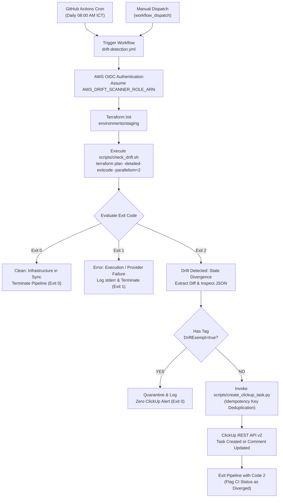
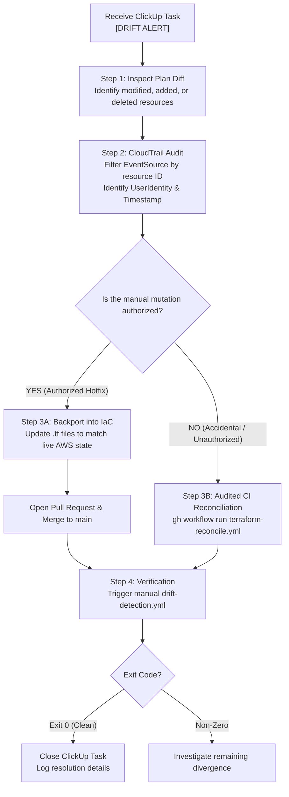

# Operational Runbook: Automated Terraform Drift Detection & ClickUp Alerting

## 1. Executive Summary & Objective

Modern cloud operations require absolute state synchronization between codified Infrastructure as Code (IaC) configurations and live cloud resources. When out-of-band modifications occur—whether via manual AWS Management Console interventions during emergencies, untracked automated scripts, or uncommitted branch divergence—**configuration drift** introduces silent architectural risks, compliance breaches, and catastrophic deployment collisions.

The automated **Terraform Configuration Drift Detection Pipeline** solves this problem through:
- **Scheduled Continuous Auditing**: Daily state sweeps scheduled at 08:00 AM ICT (01:00 AM UTC).
- **Zero-Lag Incident Escalation**: Immediate conversion of non-zero Terraform plan exit codes into actionable, deduplicated incident tasks within ClickUp.
- **Root-Cause Telemetry**: Embedding sanitized plan diffs and cryptographic idempotency keys (`drift-hash-<sha256>`) directly into task bodies.
- **Strict Blast Radius Governance**: Automated reconciliation applies are strictly prohibited. Reconciliation and rollback execute exclusively via audited, branch-protected GitHub Actions workflows.



---

## 2. Architectural Decision Record (ADR)

### ADR-01: Standard Python Library vs. External Package Dependencies
* **Context**: CI/CD automation scripts frequently invoke third-party HTTP clients like `requests` or `httpx`. On ephemeral GitHub Actions runners or minimal container instances, third-party packages necessitate `pip install`, dependency caching, virtual environment allocation, and ongoing vulnerability scanning (Dependabot alerts).
* **Decision**: Implement [`scripts/create_clickup_task.py`](file:///c:/Users/Onelink/OneDrive%20-%20Onelink%20Technology%20Co.,%20Ltd/202610_New_Cloud/20261024_2328_terraform_drift_automation/scripts/create_clickup_task.py) strictly using Python standard library modules (`urllib.request`, `urllib.error`, `json`, `os`, `sys`, `argparse`, `datetime`, `hashlib`).
* **Consequences**: Sub-50ms execution overhead, zero dependency drift across runner upgrades, zero Dependabot CVE alerts.

### ADR-02: Preserving Exit Code Fidelity (`terraform_wrapper: false`)
* **Context**: The official GitHub Action `hashicorp/setup-terraform` defaults to wrapping the `terraform` CLI with a Node.js shim that collapses exit code 2 (drift detected) into standard step failures (code 1) or success (code 0).
* **Decision**: Explicitly configure `terraform_wrapper: false` within [`.github/workflows/drift-detection.yml`](file:///c:/Users/Onelink/OneDrive%20-%20Onelink%20Technology%20Co.,%20Ltd/202610_New_Cloud/.github/workflows/drift-detection.yml).
* **Consequences**: Raw detailed exit codes (0 = clean, 1 = execution error, 2 = drift, 3 = alerting failure) are passed directly to the shell pipeline uncorrupted.

### ADR-03: Distributed Idempotency Key Deduplication
* **Context**: In scheduled daily pipelines, unresolved drift triggers duplicate Priority 1 tasks every 24 hours, causing alert fatigue.
* **Decision**: Compute a deterministic SHA256 drift hash across drifted resource addresses (`drift-hash-<sha256>`). Query ClickUp for open tasks with this tag; if active, append a persistence comment instead of spawning duplicate tasks.

### ADR-04: S3 Native Locking Decoupled Write Governance
* **Context**: Terraform 1.10+ native locking uses S3 conditional writes on `.tflock`. A scanner role cannot be granted write access to state files.
* **Decision**: Decouple S3 permissions: grant `s3:GetObject` on `terraform.tfstate`, but grant `s3:PutObject` and `s3:DeleteObject` strictly scoped to `*.tflock`.
* **Consequences**: Scanner participates in distributed locking with zero risk of state corruption.

---

## 3. Implementation Log & Asset Mapping

| File Path | Role & Operational Responsibility |
| :--- | :--- |
| [`.github/workflows/drift-detection.yml`](file:///c:/Users/Onelink/OneDrive%20-%20Onelink%20Technology%20Co.,%20Ltd/202610_New_Cloud/.github/workflows/drift-detection.yml) | Orchestrates daily cron (`0 1 * * *` UTC), OIDC role assumption, setup-terraform, and check_drift execution. |
| [`.github/workflows/terraform-reconcile.yml`](file:///c:/Users/Onelink/OneDrive%20-%20Onelink%20Technology%20Co.,%20Ltd/202610_New_Cloud/.github/workflows/terraform-reconcile.yml) | Audited CI/CD reconciliation pipeline with 2-maintainer approval quorum. |
| [`.github/workflows/terraform-rollback.yml`](file:///c:/Users/Onelink/OneDrive%20-%20Onelink%20Technology%20Co.,%20Ltd/202610_New_Cloud/.github/workflows/terraform-rollback.yml) | Single-command deterministic rollback workflow with automated destroy count assertions. |
| [`scripts/check_drift.sh`](file:///c:/Users/Onelink/OneDrive%20-%20Onelink%20Technology%20Co.,%20Ltd/202610_New_Cloud/20261024_2328_terraform_drift_automation/scripts/check_drift.sh) | Shell harness executing `terraform plan -detailed-exitcode -parallelism=2`, isolating exit codes, exporting plan JSON, and dispatching ClickUp alerts. |
| [`scripts/create_clickup_task.py`](file:///c:/Users/Onelink/OneDrive%20-%20Onelink%20Technology%20Co.,%20Ltd/202610_New_Cloud/20261024_2328_terraform_drift_automation/scripts/create_clickup_task.py) | Python stdlib client parsing plan JSON for `DriftExempt` tag quarantine, computing SHA256 idempotency keys, and posting/deduplicating ClickUp tasks. |
| [`environments/staging/main.tf`](file:///c:/Users/Onelink/OneDrive%20-%20Onelink%20Technology%20Co.,%20Ltd/202610_New_Cloud/20261024_2328_terraform_drift_automation/environments/staging/main.tf) | Staging baseline with Terraform 1.10+ native lockfile, S3 Gateway VPC Endpoint, and drift canary security group. |

---

## 4. Operational Runbook (Junior Onboarding Guide)

### Incident Trigger: What Happens When Exit Code 2 is Tripped?
When `terraform plan -detailed-exitcode` detects changes:
1. `check_drift.sh` intercepts code `2` and exports the plan to binary and JSON.
2. `create_clickup_task.py` checks for `DriftExempt = "true"` tags:
   - If all drifted resources are tagged with `DriftExempt = "true"`, the pipeline logs `[QUARANTINE]` and exits clean (`Exit 0`).
   - If non-exempt changes exist, the script computes `drift-hash-<sha256>`.
3. If an open task with this hash exists, ClickUp appends a comment (`[DRIFT PERSISTS]`). If new, an **Urgent (Priority 1)** task is created.
4. The pipeline terminates with code `2` to alert CI.

---

### Step-by-Step Triage Workflow



#### Step 1: Inspect Plan Diff
Open the ClickUp task and review the diff summary block.

#### Step 2: CloudTrail Forensic Analysis
1. Open AWS Management Console (`ap-southeast-1`).
2. Navigate to **CloudTrail -> Event history**. Filter by resource ID.
3. Identify `Username`, `EventTime`, and `SourceIPAddress`.

#### Step 3: Reconciliation Execution

##### Option A: The change is AUTHORIZED (Emergency Hotfix)
1. Open a Git feature branch on your workstation.
2. Update the `.tf` code to codify the live manual change.
3. Submit a Pull Request and merge to `main`.

##### Option B: The change is UNAUTHORIZED / ACCIDENTAL
**DO NOT RUN LOCAL `terraform apply`.** Execute audited CI/CD reconciliation:
```bash
gh workflow run terraform-reconcile.yml \
  -f environment=20261024_2328_terraform_drift_automation/environments/staging \
  -f reason="Reverting unauthorized SG ingress rule modification"
```
*(Requires 2-engineer approval via GitHub Environment Protection Rules)*

#### Step 4: Verification & Sign-Off
1. Re-run drift detection:
   ```bash
   gh workflow run drift-detection.yml \
     -f environment=20261024_2328_terraform_drift_automation/environments/staging
   ```
2. Confirm Exit Code 0 (`STATUS: CLEAN`). Close ClickUp task.

---

### Deterministic Single-Command Rollback Procedure

If reconciling drift causes application instability, execute single-command rollback:
```bash
gh workflow run terraform-rollback.yml \
  -f environment=20261024_2328_terraform_drift_automation/environments/staging \
  -f target_commit=<LAST_KNOWN_STABLE_SHA>
```
The workflow verifies that `destroy_count <= 5` before executing apply.

---

## 5. Reference Environment Variables & Secrets

### Required Secrets & Variables (GitHub Actions)

| Name | Scope | Description |
| :--- | :--- | :--- |
| `TF_STATE_BUCKET` | **Mandatory** | S3 remote state bucket name. Injected via `-backend-config="bucket=${TF_STATE_BUCKET}"`. |
| `CLICKUP_API_TOKEN` | **Mandatory** | ClickUp Personal/Service API Token (starts with `pk_`). |
| `CLICKUP_LIST_ID` | **Mandatory** | Numeric List ID from ClickUp URL. |
| `AWS_DRIFT_SCANNER_ROLE_ARN` | **Mandatory** | IAM Role ARN configured for GitHub OIDC federated trust (Read-Only inspection & scoped `.tflock` write). |
| `AWS_RECONCILE_ROLE_ARN` | **Mandatory (Reconciliation)** | IAM Role ARN configured for GitHub OIDC with mutation rights (e.g. `ec2:AuthorizeSecurityGroup*`). Assumed exclusively by `terraform-reconcile.yml` and `terraform-rollback.yml` under 2-maintainer approval quorum. |
| `AWS_REGION` | *Optional* | Target region (default `ap-southeast-1`). |

---

### Hardened AWS OIDC IAM Trust Policy Configuration

```json
{
  "Version": "2012-10-17",
  "Statement": [
    {
      "Effect": "Allow",
      "Principal": {
        "Federated": "arn:aws:iam::<AWS_ACCOUNT_ID>:oidc-provider/token.actions.githubusercontent.com"
      },
      "Action": "sts:AssumeRoleWithWebIdentity",
      "Condition": {
        "StringEquals": {
          "token.actions.githubusercontent.com:aud": "sts.amazonaws.com",
          "token.actions.githubusercontent.com:sub": "repo:<GITHUB_ORG>/<GITHUB_REPO>:ref:refs/heads/main"
        }
      }
    }
  ]
}
```

---

### IAM Permissions Policy for Read-Only Drift Scanner with Scoped Locking

```json
{
  "Version": "2012-10-17",
  "Statement": [
    {
      "Sid": "StateFileStrictReadOnly",
      "Effect": "Allow",
      "Action": [
        "s3:GetObject"
      ],
      "Resource": "arn:aws:s3:::<TF_STATE_BUCKET>/staging/drift-canary/terraform.tfstate"
    },
    {
      "Sid": "TerraformS3StateListScoped",
      "Effect": "Allow",
      "Action": "s3:ListBucket",
      "Resource": "arn:aws:s3:::<TF_STATE_BUCKET>",
      "Condition": {
        "StringLike": {
          "s3:prefix": ["staging/drift-canary/*"]
        }
      }
    },
    {
      "Sid": "StateLockCoordinationScopedWrite",
      "Effect": "Allow",
      "Action": [
        "s3:PutObject",
        "s3:DeleteObject"
      ],
      "Resource": "arn:aws:s3:::<TF_STATE_BUCKET>/staging/drift-canary/terraform.tfstate.tflock"
    },
    {
      "Sid": "StateKmsDecryptAccess",
      "Effect": "Allow",
      "Action": [
        "kms:Decrypt",
        "kms:DescribeKey"
      ],
      "Resource": "arn:aws:kms:ap-southeast-1:<AWS_ACCOUNT_ID>:key/<KMS_KEY_ID>"
    },
    {
      "Sid": "InfrastructureInspectionReadOnly",
      "Effect": "Allow",
      "Action": [
        "ec2:DescribeSecurityGroups",
        "ec2:DescribeSecurityGroupRules",
        "ec2:DescribeVpcs",
        "ec2:DescribeSubnets",
        "ec2:DescribeVpcEndpoints"
      ],
      "Resource": "*"
    }
  ]
}
```

---

### Exit Code & CI Notification Matrix

| Exit Code | Classification | Meaning & Operational Action | GitHub Actions Feedback |
| :---: | :--- | :--- | :--- |
| **`0`** | **Clean** | No drift detected, or all drifts quarantined via `DriftExempt=true`. | Clean step summary. |
| **`1`** | **Execution Error** | Terraform plan, initialization, or syntax error occurred. | `::error::` annotation with execution failure log. |
| **`2`** | **Drift Detected** | Drift identified and Urgent ClickUp task created/updated. | `::warning::` annotation with ClickUp Task URL. |
| **`3`** | **Alerting Failure** | Drift detected, but ClickUp task dispatch failed. | `::error::` annotation warning of alerting failure. |

---

## 6. Quickstart: Running Your First Live Canary Drill

### Step 1: Deploy Canary via Audited CI/CD Pipeline
Trigger initial deployment via GitHub Actions:
```bash
gh workflow run terraform-reconcile.yml \
  -f environment=20261024_2328_terraform_drift_automation/environments/staging \
  -f reason="Deploying baseline drift canary"
```

### Step 2: Inject Live Drift (Out-of-Band Console Mutation)
1. Open AWS Management Console (`ap-southeast-1`).
2. Navigate to Security Groups -> `onelink-staging-drift-canary-sg`.
3. Add an unauthorized inbound rule (e.g., SSH port 22 from `0.0.0.0/0`).
4. Click **Save rules**.

### Step 3: Execute Drift Scanner
```bash
gh workflow run drift-detection.yml \
  -f environment=20261024_2328_terraform_drift_automation/environments/staging
```

### Step 4: Verify ClickUp Task & Deduplication
1. Confirm an Urgent task titled `[DRIFT ALERT] Infrastructure Drift Detected - ...` is created.
2. Run the workflow a second time without fixing the drift. Confirm ClickUp appends a `[DRIFT PERSISTS]` comment with zero duplicate tasks created.

### Step 5: Test Break-Glass Quarantine (`DriftExempt = "true"`)
1. In the AWS Console, tag `onelink-staging-drift-canary-sg` with `DriftExempt = "true"`.
2. Re-run `drift-detection.yml`.
3. Confirm output: `[QUARANTINE] All detected resource mutations possess DriftExempt=true. Exiting clean (Exit 0)`.

### Step 6: Reconcile via Protected Workflow
Remove the unauthorized rule and verify clean status:
```bash
gh workflow run terraform-reconcile.yml \
  -f environment=20261024_2328_terraform_drift_automation/environments/staging \
  -f reason="Reconciling canary back to code baseline"
```
Drill complete.
